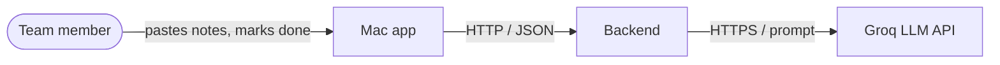
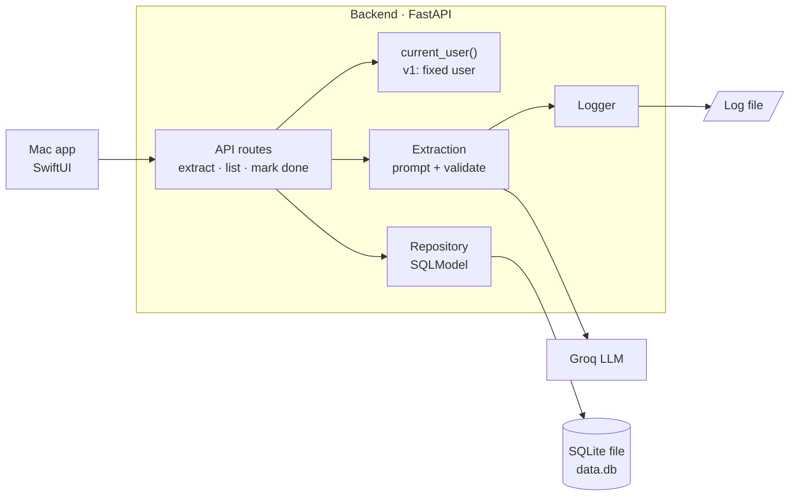
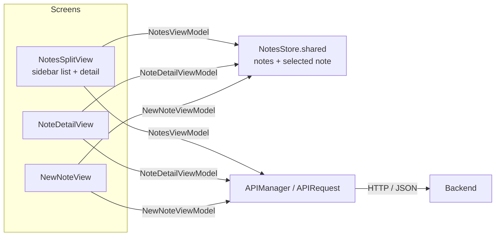
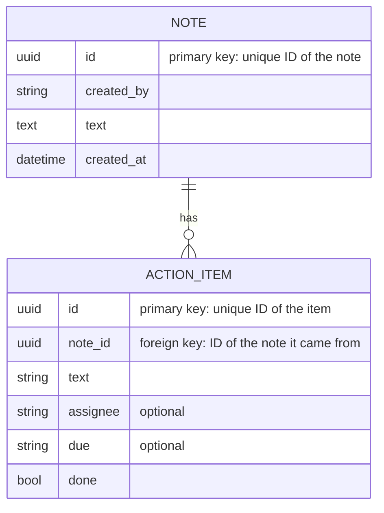
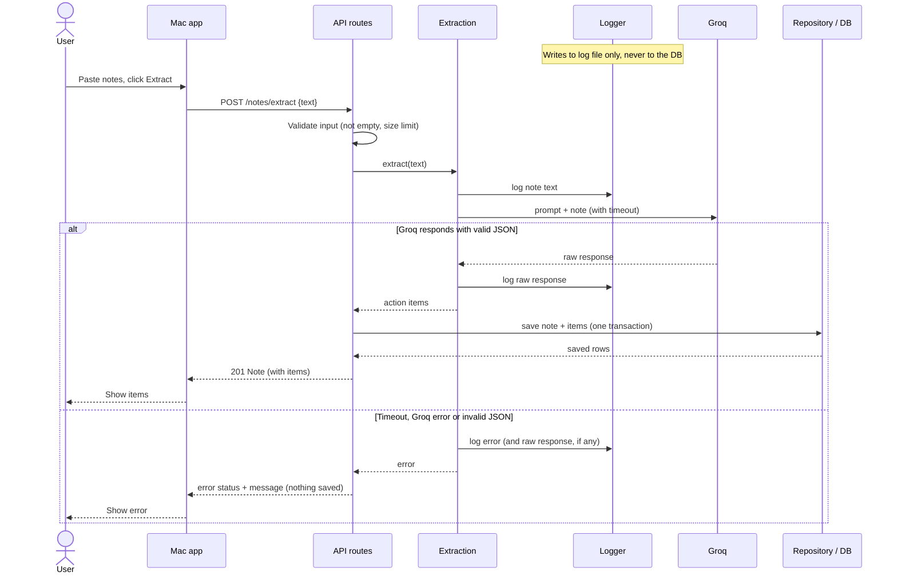
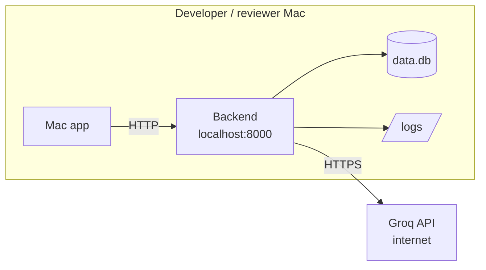
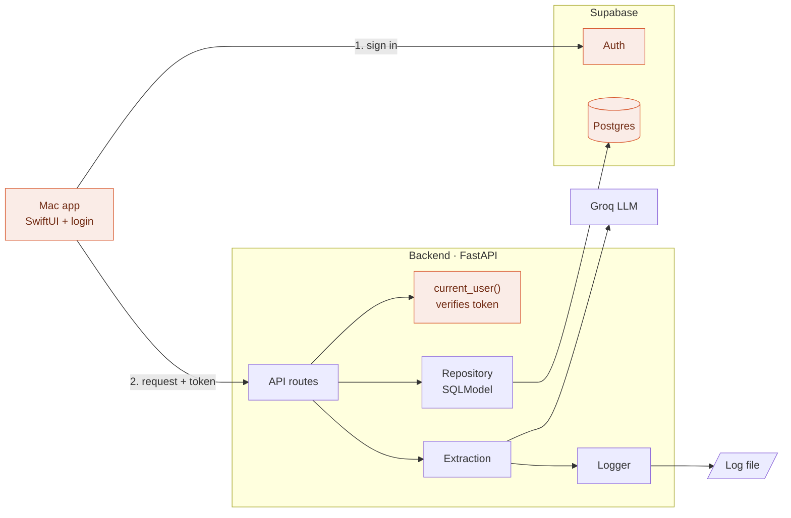

# Architecture

Requirements: [Assignment.md](Assignment.md). Decisions: [Decisions.md](Decisions.md). Tools and libraries: [Stack.md](Stack.md).

- **v1 (MVP):** what we build now. No auth, SQLite, runs locally.
- **v2 (post-MVP):** Supabase Auth + Postgres. Designed for, not built.

---

## Overview

A team member pastes meeting notes into the Mac app. The backend sends them to Groq, validates the returned JSON, saves the note with its action items, and returns them. Items can't be edited, only marked done.

## Components (v1)

| Component | Responsibility |
|---|---|
| **API routes** | HTTP endpoints only: parse request, call services, return response. No business logic. |
| **current_user()** | FastAPI *dependency* (runs before each route, injects a value). v1 returns a fixed `local-user`. The only place auth will live. |
| **Extraction** | Builds the prompt, calls Groq with a timeout, validates the JSON against a schema (Pydantic). Raises an error on anything unusable. |
| **Repository** | The only code that touches the DB. Saves a note and its items in one transaction. Always filters by `created_by`. |
| **Logger** | Writes the full note and the raw LLM response for every attempt, including failures. |

## Mac app (v1)

SwiftUI, macOS 26+. Source: `MacApp/ActionItemsGenerator/ActionItemsGenerator/`.

| Part | Responsibility |
|---|---|
| **Screens** (`Sources/Features/`) | One folder per screen, holding its view and ViewModel. Each view creates and owns its ViewModel; child views get plain values or closures. |
| **NotesStore** (`Sources/Store/`) | Shared singleton and the single source of truth for the notes and the selected note. `@Published` properties; ViewModels subscribe with Combine. |
| **APIManager / APIRequest** (`Sources/Networking/`) | Builds the request for each endpoint, sends it with `URLSession`, decodes JSON (snake_case, ISO 8601 dates). Every failure becomes a typed `APIError`; backend error bodies decode into `ServerError`. |
| **Strings / Icons** (`Resources/`) | All user-facing text and SF Symbol names. |

**Flows:**
- **Load / reload:** `NotesViewModel.loadNotes()` runs at launch and from the reload button (⌘R). It calls `GET /notes` and puts the result in the store. The sidebar shows a spinner, the list, or an error with Try Again (`LoadState`).
- **Extract:** `NewNoteViewModel` sends the editor text to `POST /notes/extract`. On success the note is added to the store and selected; on failure the error is shown and the draft is kept.
- **Mark done:** `NoteDetailViewModel` flips the item in the store right away, so the UI never waits. At most one `PATCH /items/{id}` runs per item; when it finishes, one more is sent if the user clicked again meanwhile (latest click wins). A failed save puts the item back.

## API (v1)

Request and response JSON: [API.md](API.md).

| Method | Path | Purpose |
|---|---|---|
| `POST` | `/notes/extract` | Submit note text, get back saved action items |
| `GET` | `/notes` | List notes with their action items |
| `PATCH` | `/items/{id}` | Mark an item done or undone (the only allowed change) |

## Data model

## Extraction flow

## Running locally (v1)

Everything runs on one Mac. No hosting. The backend listens on `127.0.0.1` only, so other devices on the network can't reach it.

## How it handles…

Full list of failure cases, status codes and the error format: [ErrorHandling.md](ErrorHandling.md).

- **Bad LLM output:** the response is parsed into Pydantic models (schema classes, similar to `Codable` structs). If parsing fails, the whole submission is rejected and nothing is saved.
- **Errors:** every failure maps to an HTTP status and a short JSON error the app can show. Input errors are `4xx` (client's fault). LLM failures and timeouts are `5xx` (upstream's fault).
- **Saving:** the note and its items are saved in one transaction, all or nothing.
- **Logging:** the note text and raw LLM response are logged for every extraction, with a request ID to tie them together.
- **Ownership:** every note has `created_by`, and every query filters by it. In v1 it's always `local-user`.
- **API key:** the Groq key lives only in the backend's environment (`.env`, not committed). The Mac app never sees it. It only talks to our backend, because anything shipped inside an app can be extracted.
- **Configuration:** Groq key, DB URL and backend URL come from config or environment, never hard-coded. Secrets aren't committed.
- **Immutability:** there's no endpoint to edit items. Only `done` can change.

---

## v2 (post-MVP): auth + hosted database

Each user sees only their own notes (sharing comes later), and the team uses one shared server.

**What changes** (highlighted):

| Part | v1 | v2 |
|---|---|---|
| Mac app | No login | Sign-in screen (Supabase Swift SDK), sends token in `Authorization` header |
| `current_user()` | Returns `local-user` | Verifies token signature, returns real user ID, or `401 Unauthorized` |
| Database | SQLite file | Supabase Postgres (change the connection string) |
| Deployment | Local Mac | Backend hosted on a server the team can reach |

**Unchanged:** routes, extraction, logging, repository code, Groq, data model (`created_by` already exists).

**Caveats:**
- Existing v1 data needs a one-time migration from SQLite to Postgres, or start fresh.
- v1 rows owned by `local-user` must be reassigned to a real user if kept.
- Hosting is a deployment task, not a code change.
- Sharing a note with others needs an extra `note_shares` table (note ID, user ID).
